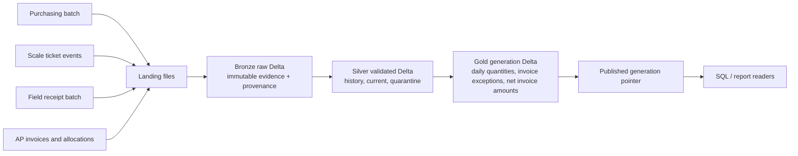

# Architecture and report contract

All example feeds and outputs are synthetic. A local run reads only the six named source prefixes from `landing/`; expected answers and scenario manifests are kept outside that prefix.

Bronze stores what arrived, including source file hashes and ingestion batches. Silver holds revision history, current validated records, delivery status, reconciliation, and quarantine. Gold products are written beneath a unique generation directory. Readers resolve all products through the single `current_generation.json` pointer and must not read staged generation directories directly. The local pointer is atomically replaced only after all reporting writes succeed. Databricks object-store behavior remains unverified.

## Consumer queries

For the local CLI use `.venv/bin/python -m construction_data_platform.cli report --root <root>` to resolve the active generation and print a synthetic report. The Delta products are also readable through PySpark using paths under `tables/gold/generations/<generation>/`. Workspace SQL registration and dashboard execution are not configured. Keep a single generation ID across all products in a consumer query. `scripts/render-report.py` exports the actual latest run report as a self-contained synthetic HTML report; it does not query Delta independently or claim live freshness.

Daily quantity grain: project, material, project-local receipt date; measure: accepted net metric tonnes. Invoice exception grain: invoice line; exception rows carry the source invoice, PO, allocation, and delivery evidence. Net invoice amount grain: company, supplier, currency; credits use positive source amounts and signed negative reporting values. No product initiates payments.
